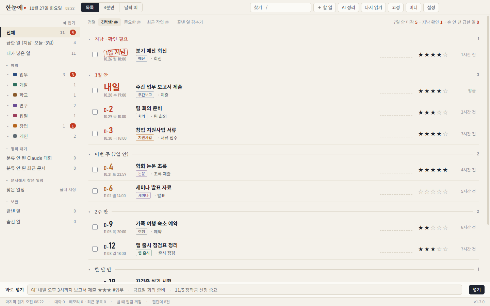
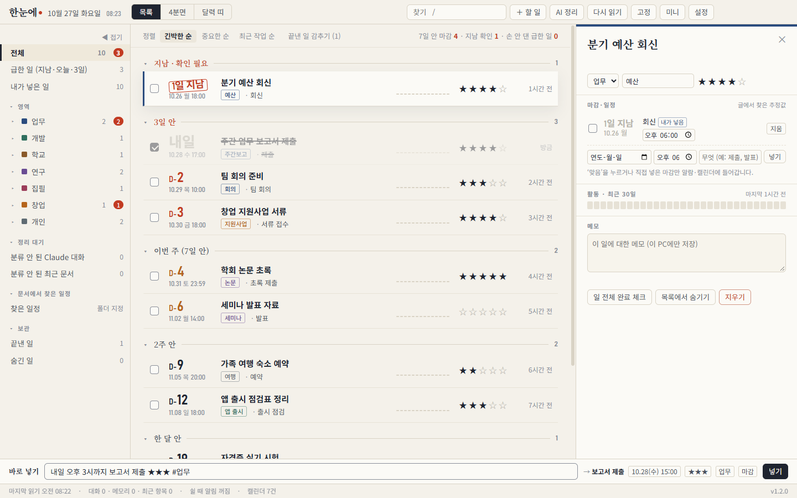
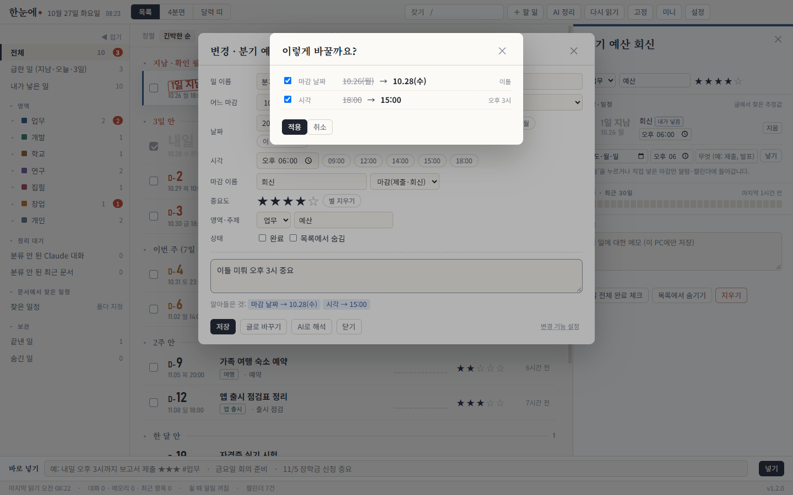
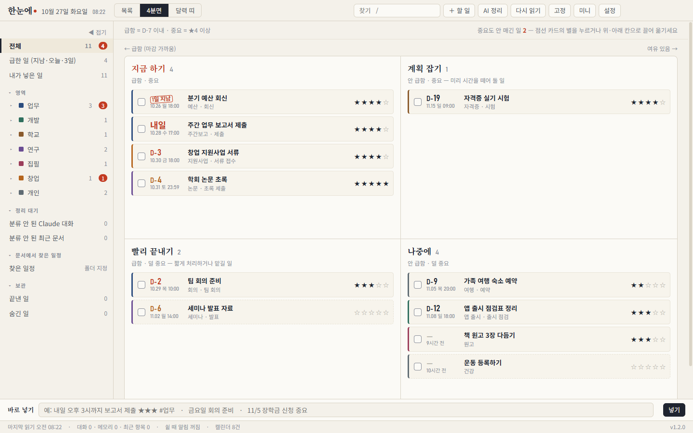
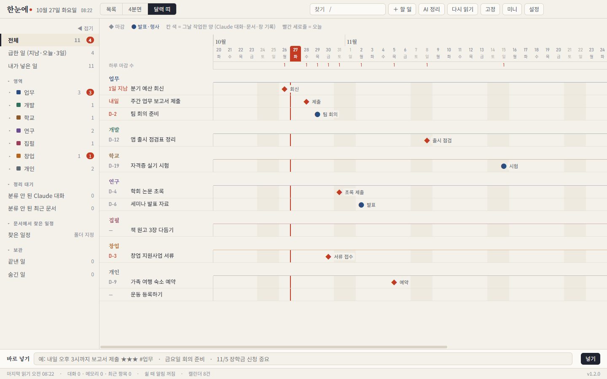

# 한눈에 일정판

할 일과 마감을 **급한 순서대로 한눈에** 보는 데스크톱 앱입니다. 윈도우와 맥에서 돌아갑니다.



<sub>English: Hannune is a Korean-first desktop deadline board for Windows and macOS. Add tasks in plain Korean, reschedule them by typing, find deadlines inside your documents, sync to Google Calendar, and optionally use a free AI agent.</sub>

---

## 이런 걸 합니다

- **세 가지 화면**: 목록(급한 순), 4분면(급함 × 중요), 달력 띠(앞뒤 8주)
- **글로 바로 넣기**: 아래 칸에 `내일 오후 3시까지 보고서 제출 ★★★`처럼 쓰고 Enter를 누르면 됩니다.
- **글로 바꾸기**: 목록에서 오른쪽 클릭 → `이틀 미뤄 줘`, `다음주 금요일 3시`, `별 넷`, `완료`라고 쓰면 됩니다. 오타와 띄어쓰기가 틀려도 알아듣고, 바꾸기 전에 확인 창을 보여 줍니다.
- **완료 체크**: 체크하면 줄이 그어지고 흐리게 바뀝니다.
- **문서에서 마감 찾기**: 폴더를 지정하면 그 안의 한글·워드·PDF·엑셀·파워포인트 문서에서 마감 날짜를 찾아 줍니다.
- **알림**: 마감 1일·5시간·1시간 전에 알려 주고, **구글 캘린더**에 자동으로 넣습니다. 폰과 삼성 캘린더에서도 보입니다.
- **쉴 때 알림**: 한동안 키보드·마우스를 쓰지 않으면 창이 앞으로 나와 급한 일을 보여 줍니다. 항상 위에 떠 있는 **미니 창**도 있습니다.
- (선택) **무료 AI 에이전트**: Gemini 무료 키, Groq, OpenRouter 무료 모델, 내 PC에서 돌리는 Ollama, Claude Code 중에서 고를 수 있습니다.

---

## 내려받기

👉 **[최신판 내려받기](../../releases/latest)**

| 내 컴퓨터 | 받을 파일 |
|---|---|
| 윈도우 10·11 | `Hannune-Setup-…exe` |
| 맥 (애플 칩 M1·M2·M3·M4) | `Hannune-…-mac-arm64.dmg` |
| 맥 (인텔) | `Hannune-…-mac-x64.dmg` |

> 내 맥이 어느 쪽인지 모르겠으면 화면 왼쪽 위 사과 메뉴 › **이 Mac에 관하여**를 엽니다. 칩이 "Apple M…"이면 arm64, "Intel"이면 x64입니다.

---

## 설치하기

### 윈도우

1. 내려받은 `Hannune-Setup-…exe`를 두 번 누릅니다.
2. 파란 창 **"Windows의 PC 보호"**가 뜨면 **추가 정보** → **실행**을 누릅니다.
   (유료 서명 인증서가 없는 무료 앱이라 나오는 안내입니다.)
3. 설치가 끝나면 앱이 바로 켜집니다. 바탕화면과 시작 메뉴에 **한눈에 일정판**이 생깁니다. 설정의 앱 목록에는 영문 이름 **Hannune**으로 보입니다.

### 맥

1. 내려받은 `.dmg`를 엽니다.
2. 열린 창에서 **Hannune** 앱 아이콘을 **Applications(응용 프로그램)** 폴더로 끌어 놓습니다.
3. 응용 프로그램에서 **Hannune**(한눈에 일정판)을 엽니다.
   - **"확인되지 않은 개발자"** 안내가 나오면 **시스템 설정 › 개인정보 보호 및 보안**으로 갑니다. 아래쪽 "Hannune"이 차단되었다는 줄에서 **그래도 열기**를 누릅니다.
   - **"손상되었기 때문에 열 수 없습니다"**가 나오면 터미널(응용 프로그램 › 유틸리티 › 터미널)에 아래 한 줄을 붙여 넣고 Enter를 누릅니다. 그다음 다시 엽니다.
     ```
     xattr -cr /Applications/Hannune.app
     ```
   (애플 유료 인증을 받지 않은 무료 앱이라 처음 한 번만 나오는 안내입니다.)

### 지우기

- 윈도우: **설정 › 앱 › 설치된 앱**에서 "Hannune" › 제거
- 맥: 응용 프로그램 폴더의 Hannune을 휴지통으로 끌어 놓기

> 윈도우·맥 설치본은 배포하기 전에 GitHub의 윈도우, 맥(애플 칩), 맥(인텔) 컴퓨터에서 실제로 켜 보는 시험을 통과한 것만 올립니다.

---

## 처음 쓰기 (3분)

**1. 할 일 넣기**: 창 아래 **바로 넣기** 칸에 쓰고 Enter를 누릅니다.

| 이렇게 쓰면 | 이렇게 들어갑니다 |
|---|---|
| `내일 오후 3시까지 보고서 제출 ★★★` | 보고서 제출 · 내일 15:00 · 중요도 3 |
| `금요일 팀 회의 #업무` | 팀 회의 · 이번 주 금요일 · 업무 영역 |
| `11/5 장학금 신청 중요` | 장학금 신청 · 11월 5일 · 중요도 4 |



**2. 바꾸기**: 목록에서 **오른쪽 클릭**하면 변경 창이 뜹니다. 단추로 바꿔도 되고, 아래 칸에 글로 써도 됩니다.



| 4분면 (급함 × 중요) | 달력 띠 (앞뒤 8주) |
|---|---|
|  |  |

**3. 폴더 연결 (선택)**: 설정에서 고릅니다.
- **작업 폴더**: 프로젝트 폴더들이 모여 있는 곳입니다. 그 안의 폴더 하나하나가 '일'이 됩니다.
- **일정 찾을 폴더**: 공문·안내문이 쌓이는 곳입니다. 문서 속 마감 날짜를 찾아 '찾은 일정'에 모읍니다. 스위치를 켠 것만 목록에 들어갑니다.

**4. 구글 캘린더 연결 (선택, 2분, 처음 한 번만)**: 설정 › **구글 캘린더 연결**에서 합니다.
1. **① 연결 코드 복사**를 누릅니다.
2. **② script.new 열기**를 누르고, 열린 창 안의 글을 모두 지운 뒤 붙여 넣고 저장합니다(Ctrl+S, 맥은 ⌘S).
3. 오른쪽 위 **배포 › 새 배포 › 웹 앱**을 고르고, 실행은 **나**, 액세스 권한은 **모든 사용자**로 정한 뒤 **배포**를 누릅니다. 권한 승인 창에서는 **고급 › 이동 › 허용**을 누릅니다.
4. 나온 **웹 앱 URL**을 앱에 붙여 넣고 **③ 연결**을 누릅니다.

그 뒤로는 마감이 바뀔 때마다 구글 캘린더의 "한눈에 마감" 캘린더에 자동으로 넣고, 고치고, 지웁니다. 알람도 함께 들어갑니다.

**5. AI 에이전트 (선택, 무료)**: 설정 › **AI 에이전트**에서 고릅니다. AI가 없어도 모든 기능이 돌아갑니다.
- **Gemini (권장)**: **무료 키 받으러 가기**를 누릅니다. 구글 계정으로 키를 만든 뒤 복사해서 붙여 넣고 **연결 시험**을 누릅니다.
- **Ollama (인터넷 없이, 완전 무료)**: [ollama.com](https://ollama.com/download)에서 설치합니다. 명령창에서 `ollama pull qwen2.5:7b`를 한 번 실행한 뒤 Ollama를 고릅니다.

---

## 알아듣는 말

| 쓰기 | 뜻 |
|---|---|
| 오늘, 내일, 모레, 글피, 다음주 금요일, 담주 월욜, 주말 | 그날 |
| 11/5, 11.5, 11월 5일, 1105, 20261105, 5일, 월말, 다음달 3일 | 그날 |
| 3일 뒤, 일주일 후 | 오늘부터 세어서 |
| 이틀 미뤄, 하루 당겨, 일주일 뒤로 | 지금 마감에서 옮기기 |
| 오후 3시 반, 15:30, 세시, 정오 | 시각 (오전·오후를 안 쓰면 1~6시는 오후로 봄) |
| 30분 미뤄, 1시간 당겨 | 시각 옮기기 |
| ★★★, 별 셋, 중요도 3, 중요, 매우 중요, 조금 중요, 안 중요 | 중요도 |
| 완료, 끝났어, 완료 취소, 숨겨 | 상태 |
| 학교로 옮겨, #업무 | 영역 |
| 제목을 주간보고로 바꿔 | 이름 |

오타(변겅·오젼·모래·월욜 등)와 띄어쓰기는 알아서 맞춰 읽습니다. 자주 쓰는 내 말은 변경 창 › **변경 기능 설정**에서 등록할 수 있습니다. 예: `칼퇴` = 18:00, `땡겨` = 하루 당기기, `불금` = 금요일.

---

## 단축키

| 키 | 하는 일 |
|---|---|
| 1 · 2 · 3 | 목록 · 4분면 · 달력 띠 |
| ↑ ↓ | 고르기 |
| E 또는 오른쪽 클릭 | 변경 창 |
| X | 완료 체크 |
| Shift + 1~5 | 중요도 |
| Q | 바로 넣기 칸으로 |
| / | 찾기 |
| Ctrl+Alt+H | 창 열기·숨기기 |
| Ctrl+Alt+M | 미니 창 |
| 트레이 아이콘 오른쪽 클릭 | 모니터 가운데로 옮기기, 끝내기 |

---

## 내 정보는 어디에?

- 모든 기록은 **이 컴퓨터 안에만** 저장됩니다.
  - 윈도우: `%APPDATA%\Hannune\data`
  - 맥: `~/Library/Application Support/Hannune/data`
- 밖으로 나가는 경우는 내가 켰을 때뿐입니다.
  - 구글 캘린더를 연결하면 마감 이름·날짜·알람이 **내 구글 계정**으로 갑니다.
  - AI 에이전트를 켜면 정리할 글이 **고른 AI**로 갑니다. Ollama는 내 PC 안에서만 돕니다.
- 창 사용 기록(윈도우, 선택 기능)은 처음에 꺼져 있습니다. 켜면 화면 위에 "● 창 기록 중"이 보입니다.
- Claude Code를 쓰는 사람은 그 메모리·대화 기록(`~/.claude`)을 읽어 프로젝트로 보여 줍니다. 읽기만 합니다.

---

## 개발자용

```bash
npm install
npm start            # 바로 실행
npm run dist:win     # 윈도우 설치본 → dist/
npm run dist:mac     # 맥 설치본(맥에서)
```

`v1.2.0` 같은 태그를 올리면 GitHub Actions가 윈도우·맥 설치본을 만들어 **Releases**에 올립니다.

---

## 저작권

© 2026 zsdvvv. 모든 권리 보유(All rights reserved).
설치본을 내려받아 개인적으로 쓰는 것은 자유입니다. 소스를 고치거나 다시 배포하려면 먼저 허락을 받아야 합니다.
